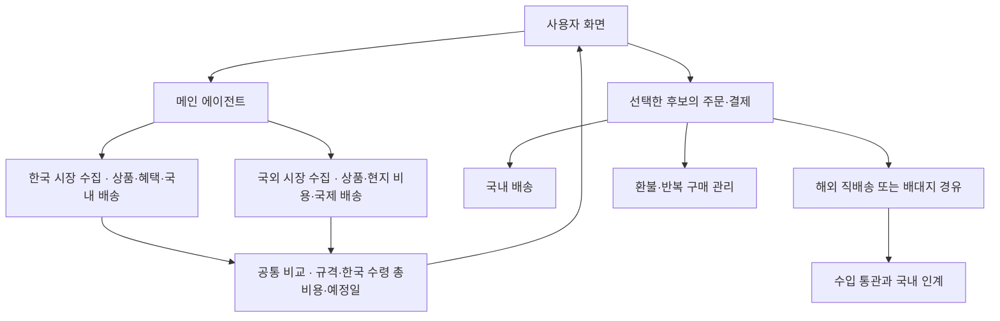

# 구매 에이전트 전체 설계

한국 시장과 국외 시장은 상품과 견적을 각각 수집한다. 수집을 마친 후보를 공통 비교 구조로 변환하고, 사용자가 고른 후보의 배송 경로에 맞춰 주문을 진행한다. 첫 구현은 단일 애플리케이션에서 국내 수집, 국외 수집, 공통 비교, 주문 처리의 경계를 나눈다. 데이터 출처와 실시간 확인 기준은 [thinking.md](thinking.md)에 정리한다.

## 전체 구조

## 시장별 수집과 배송 경로

| 구분 | 수집할 정보 | 주문 이후 연결 |
| --- | --- | --- |
| 한국 시장 | 옵션, 재고, 원화 가격, 쿠폰·포인트 적용액, 국내 배송비, 한국 수령 예정일을 수집한다. 국내 출고 상품은 이 견적으로 비교 단계에 진입한다. | 국내 출고 건은 주문 확인, 국내 배송, 수령, 필요 시 환불로 이어진다. |
| 국외 시장 | 옵션, 재고, 현지 통화, 현지 세금·배송비, 한국 직배송 가능 여부, 배대지 수락, 국제 운임, 수입세 추정, 한국 수령 예정일을 구매 경로별로 수집한다. | 직배송은 국제 운송과 통관을 추적한다. 배대지 경유는 현지 배송과 입고, 필요한 경우 합배송 실측과 출고를 추가한다. |

검색 시장과 배송 경로는 별도 값으로 기록한다. 예를 들어 한국 쇼핑몰에서 찾은 해외 직배송 상품은 한국 시장에서 수집하고, 배송 조건이 확인되면 국외 배송 견적 계산과 통관 업무를 적용한다. 출고지나 통관 조건이 빠진 후보는 확인이 필요한 항목을 표시한다.

메인 에이전트는 요청 범위에 포함된 시장만 조회한다. 한국과 국외를 모두 요청하면 두 수집 경로를 병렬로 호출하고, 먼저 도착한 결과부터 표시할 수 있다. 한쪽 공급원이 실패하면 조회된 후보를 표시하고 해당 시장의 검색 상태를 따로 보여준다.

## 시장별 수집 데이터

### 국내 수집

| 항목 | 원본 필드 | 수집 시점과 출처 |
| --- | --- | --- |
| 판매처와 상품 | `seller_id`, `offer_id`, `product_url`, `variant_id`, `product_name`, `brand`, `model_or_gtin`, `option_attributes`, `pack_size`, `unit_quantity`, `unit` | 공개 상품 정보나 판매자 피드에서 가져온다. 모델이나 GTIN이 비어 있으면 규격과 옵션으로 동일 상품 여부를 검토한다. |
| 가격·재고 | `currency`, `unit_price`, `stock_status`, `available_quantity`, `purchase_limit` | 공개 상품의 가격과 재고 여부로 후보를 만든다. 구매 가능 수량과 계정별 한도는 요청 수량으로 장바구니를 확인할 때 갱신한다. |
| 혜택·청구액 | `applied_coupon_discount`, `redeemed_points_value`, `checkout_total`, `price_tax_inclusion` | 같은 계정·옵션·수량의 장바구니나 사용자 확인값을 쓴다. 적립 예정 포인트와 이번 주문에서 사용한 포인트를 구분한다. |
| 국내 배송 | `dispatch_country`, `domestic_shipping_fee`, `remote_area_surcharge`, `shipping_method`, `order_cutoff_at`, `arrival_at_kr_from`, `arrival_at_kr_to` | 판매처의 상품 안내로 출고지를 확인하고, 목적지를 적용한 배송 견적에서 비용과 기한을 읽는다. 한국 시장의 해외 출고 상품은 아래 국외 배송 항목을 보강한다. |

### 국외 수집

| 항목 | 원본 필드 | 수집 시점과 출처 |
| --- | --- | --- |
| 판매처와 상품 | 국내와 같은 상품·옵션 식별 필드, `seller_country`, `dispatch_country`, `origin_country`, `stock_status`, `available_quantity`, `purchase_limit` | 공개 상품 정보와 장바구니에서 가져온다. 판매처 소재지, 발송국, 상품 원산지를 각각 기록한다. 용량과 단위는 원본을 보존하고 비교 시 변환한다. |
| 현지 가격·혜택·세금 | `currency`, `unit_price`, `applied_coupon_discount`, `redeemed_points_value`, `local_sales_tax`, `local_shipping_fee`, `checkout_total` | 실제로 배송할 주소를 적용한 판매처 장바구니에서 확인한다. 공공 세율 조회값으로 계산한 세액은 추정으로 기록한다. |
| 국제 배송 경로 | `direct_shipping_available`, `forwarder_address_status`, `shipping_method`, `delivery_legs`, `order_cutoff_at`, `international_shipping_fee`, `forwarder_service_fee`, `billing_weight`, `weight_basis` | 직배송과 배대지 경유 견적을 따로 만든다. 배대지 주소 수락은 판매처에서 확인하고, 운임은 요율표 추정인지 재포장 후 실측 견적인지 기록한다. |
| 수입세와 추가 비용 | `import_tax_estimate`, `customs_fee`, `included_charge_ids` | 품목, 원산지, 과세 대상 금액 등 확보한 입력으로 추정한다. 판매처 결제액에 이미 포함된 운임과 세금을 식별하고, 주문 이후 고지 세액은 원 견적과 구분해 저장한다. |

각 수집값은 `source_ref`, `observed_at`, `valid_until`, `status`를 갖는다. 시점은 시간대가 포함된 형식으로 저장하고, 제공되지 않은 만료 시각은 비워 둔다. 주문번호, 배대지 사서함 번호, 결제 정보, 통관 식별값은 관련 주문이나 배송 기록에서 관리한다.

## 공통 비교 필드와 변환 규칙

| 공통 필드 | 국내에서 매핑 | 국외에서 매핑 |
| --- | --- | --- |
| `candidate_id`, `source_quote_ref` | 판매처 견적과 구매 조건의 버전을 참조한다. | 같은 상품이라도 직배송과 배대지 견적을 각각 후보로 만들고 원본 견적 버전을 참조한다. |
| `product_key`, `variant_attributes`, `requested_quantity`, `normalized_quantity`, `normalized_unit` | 상품·옵션·묶음 단위를 정규화한다. 비교 수량은 동일한 기준 단위로 맞춘다. | 원본 상품명과 단위를 보존하고 정규화된 규격으로 매칭한다. 대응을 확인할 수 없으면 동일 상품으로 묶기 전에 확인한다. |
| `market`, `dispatch_country`, `fulfillment_route` | 검색 시장은 `KR`로 기록한다. 국내 출고는 `domestic`, 해외 출고는 확인한 배송 경로를 쓴다. | 검색 시장은 판매 시장의 국가 코드로 기록한다. 배송 경로는 `cross_border_direct` 또는 `cross_border_forwarder`로 기록한다. 출고지나 경로가 불명확하면 `unknown`을 쓴다. |
| `availability_status`, `quantity_limit`, `route_status` | 공개 재고, 수량 제한과 배송 가능 여부를 적용한다. 조건이 확인된 범위를 함께 보존한다. | 재고와 수량 제한에 더해 한국 직배송 가능 여부 또는 배대지 주소 수락 상태를 반영한다. |
| `checkout_amount`, `cost_items[]` | 이번 주문에 적용된 할인, 국내 운임, 도서산간 추가비 등의 청구 시점을 기록한다. | 현지 세금·운임, 국제 운임, 배대지 비용, 수입세 등의 청구 시점을 기록한다. 판매처 청구액에 포함된 항목은 내역 표시와 합산 여부를 구분한다. |
| `fx_rates[]`, `known_subtotal_krw`, `total_to_door_krw`, `total_status` | 원화 금액을 그대로 적용하고 한국 수령까지의 비용 합계를 계산한다. | 비용 항목의 원통화별 환율과 기준 시각으로 원화 환산 후 합산한다. 필수 비용이나 환율이 빠지면 확인된 소계와 미확인 항목을 표시하고 총액은 비워 둔다. |
| `arrival_kr_from`, `arrival_kr_to`, `arrival_status` | 해당 주소의 국내 배송 예정 범위를 기록한다. | 한국 최종 수령 기준 범위를 기록한다. 현지 배대지 도착일은 원본 배송 구간에 두고, 최종 구간이 없으면 한국 수령은 미확인으로 둔다. |
| `verification_required[]` | 수량, 쿠폰, 할증, 수령 예정일 등 확인할 항목을 담는다. | 국내와 같은 형식으로 주소 수락, 실측 운임, 수입세, 한국 도착일 등 확인할 항목을 담는다. |

- `cost_items[]`의 각 항목은 `charge_id`, `kind`, `amount_minor`, `currency`, `charge_stage`, `included_in_checkout`, `source_ref`, `status`를 갖는다. `amount_minor`에는 통화별 최소 화폐 단위의 정수를 저장한다. 할인은 차감 방향으로 기록하고, 이미 청구액에 반영된 할인은 추가로 빼지 않는다.
- 판매처 청구액이 있으면 이를 기준으로 이후 별도 청구되는 항목을 더한다. 청구액을 아직 모르면 구성 항목에서 견적을 계산하되 추정 상태를 유지한다. 모든 필수 비용의 금액이 있고 추정 항목 또는 추정 환율이 포함되면 총액을 추정으로 표시한다. 같은 장바구니·배송 경로에서 확인된 값은 해당 버전에 묶는다.
- 예를 들어 국내 후보가 배송 포함 32,000원이고 국외 후보가 판매처 청구액 25,000원에 별도 국제 운임 10,000원이라면, 수입세 확인 전 국외 후보는 ‘확인된 소계 35,000원 + 수입세 미확인’으로 표시한다. 국제 운임 10,000원이 판매처 청구액에 이미 포함됐다면 소계는 25,000원이다.

## 공통 구매 영역

| 영역 | 책임과 데이터 |
| --- | --- |
| 상품·혜택 | 상품의 용량, 옵션, 구성 수량을 맞추고 판매처별 가격, 재고, 구매 가능 수량, 쿠폰과 포인트 적용액을 관리한다. 공개 재고 여부와 계정별 구매 한도를 구분한다. |
| 견적·비교 | 판매처에서 지금 낼 금액과 이후 낼 국제 운임·수입세 예상액을 구분한다. 상품가, 현지 세금, 배송비, 할인, 통화, 한국 수령 예정일을 함께 표시한다. |
| 승인·주문·결제 | 선택한 견적, 주문 품목과 수량, 배송지, 통화, 지출 한도, 승인 만료를 연결한다. 판매처 주문과 결제의 식별자 및 결과를 각각 기록한다. |
| 배송·합배송 | 직배송과 배대지 경유를 배송 구간으로 표현한다. 주소 수락, 현지 배송, 배대지 입고, 재포장 실측, 국제 출고, 한국 수령을 추적한다. |
| 통관 | 화물 또는 신고 건별 통관 상태, 예상세액, 고지세액, 보완 서류와 기한을 관리한다. 개인통관고유부호의 유효 확인 상태와 제출용 식별값을 구분한다. |
| 환불·반복 구매 | 전체·부분 환불을 원거래에 연결한다. 반복 구매 설정이 실행될 때 새 구매 요청을 만들고 최신 견적과 승인 조건을 확인한다. |

## 데이터 관계와 상태

- 구매 요청은 여러 견적을 가질 수 있다. 주문에는 선택한 견적의 버전과 품목별 수량을 연결한다. 공급자가 가격이나 배송 조건을 바꾸면 새 견적 버전을 만들고 기존 승인 범위를 다시 검증한다.
- 주문 상품은 필요한 경우 여러 배송 건에 나누어 담을 수 있다. 반대로 여러 주문의 상품을 국제 배송 한 건에 묶을 수 있다. 연결에는 품목과 수량을 기록하고, 통관 건은 해당 화물이나 배송 건에 연결한다.
- 주문, 결제, 배송, 통관, 환불은 각각 상태를 가진다. 예를 들어 결제가 승인된 뒤에도 배송은 입고 대기 중일 수 있고, 합배송된 상품 가운데 한 품목만 부분 환불될 수 있다.
- 가격과 배송 응답에는 값, 단위, 출처, 확인 시각, 만료 시각, 확인 상태를 붙인다. 확인 상태는 출처 확인, 사용자 확인, 추정, 미확인으로 구분한다. 배송비 0원은 명시된 무료배송에 사용하고, 누락된 비용은 미확인으로 남긴다. 날짜는 배대지 도착과 한국 수령을 별도 필드로 기록한다.

## 메인 에이전트와 서브에이전트

| 구성 | 책임 |
| --- | --- |
| 메인 에이전트 | 상품 조건, 검색 시장, 예산, 수령 기한을 구조화한다. 국내 수집 도구와 국외 수집 담당을 필요한 범위에서 호출한다. 비교 결과와 확인할 항목을 제시하고, 사용자가 선택한 견적의 실행 요청을 워크플로에 넘긴다. |
| 국내 수집 도구 | 국내 출고 상품의 옵션, 재고, 혜택, 국내 배송 견적을 가져온다. 단일 판매처 조회는 어댑터를 바로 호출한다. 여러 국내 판매처의 상품 규격을 대조할 때 상품 서브에이전트를 선택적으로 호출한다. |
| 국외 수집 서브에이전트 | 국외 판매처의 옵션과 구매 조건을 대조한다. 배송 담당의 직배송·배대지 경로 견적 및 수입세 추정과 합쳐 경로별 후보를 반환한다. |
| 국외 배송 서브에이전트 | 국제 구간의 비용, 배대지 주소 수락 여부, 구간별 도착 예정일, 실측 여부를 확인한다. 해외 출고가 확인된 한국 시장 후보에도 같은 도구를 사용한다. |
| 통관 서브에이전트 | 수입 화물의 조회 결과와 보완 통지를 정리한다. 통관 진행 단계, 고지세액, 확인해야 할 문서와 기한을 반환한다. |
| 워크플로와 도메인 코드 | 동일 상품 판정 기준, 비용 합산, 기한 비교, 견적 만료, 승인 검증, 상태 전환을 담당한다. 금액과 날짜는 구조화된 입력과 명시된 규칙으로 계산한다. |
| 데이터 어댑터 | 공개 API, 구매자 세션, 가맹점 연동, CSV, 사용자 확인값을 공통 구조로 변환한다. 조회 기능과 주문·결제 실행 기능은 서로 다른 권한으로 노출한다. |

서브에이전트는 각 결과에 값, 출처, 확인 시각, 상태, 추가 확인 항목을 붙인다. 단일 API 호출로 끝나는 작업은 도구 함수로 제공하고, 여러 출처를 대조해야 할 때 서브에이전트를 둔다. 예를 들어 배송 담당이 “배대지 금요일 도착, 한국 수령일 미확인”이라고 반환하면 워크플로는 한국 수령 기한을 미확인으로 처리하고, 메인 에이전트는 한국 수령일 확인을 요청한다.

실제 주문·결제는 서버가 사용자의 승인 범위와 현재 견적을 검증한 후 진행한다. 일회성 승인은 주문, 견적 버전, 통화, 지출 한도와 만료에 묶고 한 번만 사용한다. 거래 응답을 받지 못했을 때는 같은 거래의 상태를 먼저 조회하고, 중복 알림은 한 번만 반영한다. 반복 구매도 실행할 때마다 최신 견적을 확인하며, 가격과 조건이 승인 범위를 벗어나면 사용자 확인 단계로 돌아간다.

## 단계별 구현 순서

| 단계 | 작업 | 완료 기준 |
| --- | --- | --- |
| 1. 시장별 수집과 공통 견적 설계 | 국내·국외 원본 구조와 공통 비교 후보를 정의한다. 구매 요청, 견적, 주문 상품, 결제, 배송 묶음, 통관, 환불, 반복 설정의 관계를 잡는다. | 검색 시장과 배송 경로를 따로 표현하고, 각 경로의 필수 입력과 사용자 확인 시점을 정한다. |
| 2. 국내 주문 경로 연결 | 모의 상품, 혜택, 국내 배송 견적을 사용해 비교부터 주문, 수령, 부분 환불까지 연결한다. | 국내 출고 주문 테스트에서 국제 배송 및 통관 도구 호출이 0회다. |
| 3. 국외 경로 연결과 교차 비교 | 모의 직배송·배대지 견적, 합배송, 통관 보완을 연결한다. 공개 상품 API, 워싱턴주 세율, 신청 가능한 관세청 API 및 사용자 입력을 시장별 어댑터에 추가한다. | 동일 화면에서 국내·국외 후보의 총비용과 수령 기한을 비교한다. 국외 조회가 실패해도 국내 결과가 표시되고, 한국 쇼핑몰의 해외 발송 상품은 국외 배송 경로로 연결된다. |
| 4. 운영 연동을 영역별로 추가 | 권한이 확보된 장바구니, 결제·환불, 배대지 어댑터를 단계적으로 연결한다. 판매처 결제 화면으로 넘기고 영수증으로 확인하는 경로도 제공한다. | 실거래를 활성화하기 전에 견적 변경, 승인 만료, 응답 유실, 중복 결제 요청, 부분 환불 처리를 검증한다. |
| 5. 반복 구매 활성화 | 일정이나 사용자 요청이 새 구매 건을 만들도록 한다. 최신 재고, 가격, 배송 조건, 승인 유효 상태를 확인한다. | 가격 상승이나 재고 부족 시 확인을 요청하고, 동일 실행이 재시도돼도 중복 주문을 만들지 않는다. |

초기에 합배송 운임을 사용자 입력으로 받아 전체 흐름을 검증할 수 있다. 배대지 API를 확보하면 해당 어댑터를 연결하고 동일한 견적 구조와 출고 상태를 사용한다. 상품, 결제, 통관에도 같은 방식으로 공급원을 추가한다.
