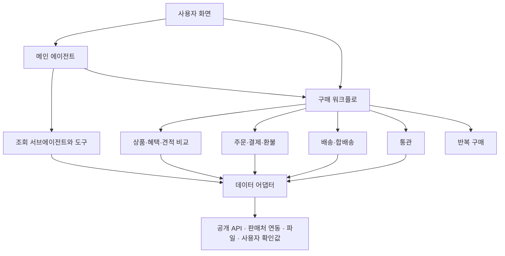

# 구매 에이전트 전체 설계

상품 검색과 비교부터 주문, 결제, 직배송·합배송, 통관, 환불, 반복 구매까지 하나의 구매 여정으로 설계한다. 첫 구현은 단일 애플리케이션에서 영역별 모듈을 둔다. 공개 API, 판매처 연동, 파일, 사용자 입력은 같은 데이터 구조로 연결한다. 데이터 출처와 실시간 확인 기준은 [thinking.md](thinking.md)에 정리한다.

## 전체 구조

| 영역 | 책임과 데이터 |
| --- | --- |
| 상품·혜택 | 상품의 용량, 옵션, 구성 수량을 맞추고 판매처별 가격, 재고, 구매 가능 수량, 쿠폰과 포인트 적용액을 관리한다. 공개 재고 여부와 계정별 구매 한도를 구분한다. |
| 견적·비교 | 판매처에서 지금 낼 금액과 이후 낼 국제 운임·수입세 예상액을 구분한다. 상품가, 현지 세금, 배송비, 할인, 통화, 한국 수령 예정일을 함께 표시한다. |
| 승인·주문·결제 | 선택한 견적, 주문 품목과 수량, 배송지, 통화, 지출 한도, 승인 만료를 연결한다. 판매처 주문과 결제의 식별자 및 결과를 각각 기록한다. |
| 배송·합배송 | 직배송과 배대지 경유를 배송 구간으로 표현한다. 주소 수락, 현지 배송, 배대지 입고, 재포장 실측, 국제 출고, 한국 수령을 추적한다. |
| 통관 | 화물 또는 신고 건별 통관 상태, 예상세액, 고지세액, 보완 서류와 기한을 관리한다. 개인통관고유부호의 유효 확인 상태와 제출용 식별값을 구분한다. |
| 환불·반복 구매 | 전체·부분 환불을 원거래에 연결한다. 반복 구매 설정이 실행될 때 새 구매 요청을 만들고 최신 견적과 승인 조건을 확인한다. |

## 데이터 관계와 상태

- 구매 요청은 여러 견적을 가질 수 있다. 주문에는 선택한 견적의 버전과 품목별 수량을 연결한다. 공급자가 가격이나 배송 조건을 바꾸면 새 견적 버전을 만들고 기존 승인 범위를 다시 검증한다.
- 주문 상품은 필요한 경우 여러 배송 건에 나누어 담을 수 있다. 반대로 여러 주문의 상품을 국제 배송 한 건에 묶을 수 있다. 연결에는 품목과 수량을 기록하고, 통관 건은 해당 화물이나 배송 건에 연결한다.
- 주문, 결제, 배송, 통관, 환불은 각각 상태를 가진다. 예를 들어 결제가 승인된 뒤에도 배송은 입고 대기 중일 수 있고, 합배송된 상품 가운데 한 품목만 부분 환불될 수 있다.
- 가격과 배송 응답에는 값, 단위, 출처, 확인 시각, 만료 시각, 확인 상태를 붙인다. 확인 상태는 출처 확인, 사용자 확인, 추정, 미확인으로 구분한다. 배송비 0원은 명시된 무료배송에 사용하고, 누락된 비용은 미확인으로 남긴다. 날짜는 배대지 도착과 한국 수령을 별도 필드로 기록한다.

## 메인 에이전트와 서브에이전트

| 구성 | 책임 |
| --- | --- |
| 메인 에이전트 | 사용자의 상품 조건, 예산, 수령 기한을 구조화한다. 필요한 조회를 조합하고, 결과를 설명하고, 사용자가 제공해야 할 확인 항목을 모아서 제시한다. 사용자 선택과 실행 요청은 워크플로에 넘긴다. |
| 상품 서브에이전트 | 판매처별 옵션명과 규격을 대조하고, 묶음 수량, 재고 여부, 한정 구매 조건의 근거를 반환한다. |
| 배송 서브에이전트 | 직배송과 배대지 경유 경로를 조사한다. 각 구간의 비용, 주소 수락 여부, 국내외 도착 예정일, 실측 여부를 반환한다. |
| 통관 서브에이전트 | 해당 화물의 조회 결과와 보완 통지를 정리한다. 진행 단계, 고지세액, 확인해야 할 문서와 기한을 반환한다. |
| 워크플로와 도메인 코드 | 동일 상품 판정 기준, 비용 합산, 기한 비교, 견적 만료, 승인 검증, 상태 전환을 담당한다. 금액과 날짜는 구조화된 입력과 명시된 규칙으로 계산한다. |
| 데이터 어댑터 | 공개 API, 구매자 세션, 가맹점 연동, CSV, 사용자 확인값을 공통 구조로 변환한다. 조회 기능과 주문·결제 실행 기능은 서로 다른 권한으로 노출한다. |

서브에이전트는 각 결과에 값, 출처, 확인 시각, 상태, 추가 확인 항목을 붙인다. 단일 API 호출로 끝나는 작업은 도구 함수로 제공하고, 여러 출처를 대조해야 할 때 서브에이전트를 둔다. 예를 들어 배송 담당이 “배대지 금요일 도착, 한국 수령일 미확인”이라고 반환하면 워크플로는 한국 수령 기한을 미확인으로 처리하고, 메인 에이전트는 한국 수령일 확인을 요청한다.

실제 주문·결제는 서버가 사용자의 승인 범위와 현재 견적을 검증한 후 진행한다. 일회성 승인은 주문, 견적 버전, 통화, 지출 한도와 만료에 묶고 한 번만 사용한다. 거래 응답을 받지 못했을 때는 같은 거래의 상태를 먼저 조회하고, 중복 알림은 한 번만 반영한다. 반복 구매도 실행할 때마다 최신 견적을 확인하며, 가격과 조건이 승인 범위를 벗어나면 사용자 확인 단계로 돌아간다.

## 단계별 구현 순서

| 단계 | 작업 | 완료 기준 |
| --- | --- | --- |
| 1. 전체 흐름과 상태 설계 | 구매 요청, 견적, 주문 상품, 결제, 배송 묶음, 통관, 환불, 반복 설정의 관계를 정의한다. 직배송, 배대지 주소 거절, 합배송, 서류 보완, 부분 환불, 반복 구매 가격 상승을 대표 시나리오로 둔다. | 주요 상태 전환의 실행 주체, 입력, 실패 시 처리, 사용자 확인 시점이 정의된다. |
| 2. 샘플 데이터로 전체 연결 | 견적 생성부터 주문, 배송, 통관, 수령, 부분 환불까지 모의 어댑터로 연결한다. 비교 계산과 상태 전환을 코드로 구현하고 화면에서 확인 절차를 연결한다. | 두 주문의 합배송과 품목 하나의 부분 환불을 표현할 수 있다. 견적 변경 시 이전 승인 검증과 사용자 확인 후 재개가 작동한다. |
| 3. 무료 조회와 사용자 입력 연결 | 공개 상품 API, 워싱턴주 세율 조회, 신청을 마친 관세청 API를 연결한다. 구매자에게만 보이는 견적과 실측 운임은 입력이나 CSV로 받는다. | 동일한 비교 화면에서 확인값, 추정값, 미확인값을 구별할 수 있다. 주소 보정, API 실패, 배송 기한 누락이 각각 올바르게 표시된다. |
| 4. 운영 연동을 영역별로 추가 | 권한이 확보된 장바구니, 결제·환불, 배대지 어댑터를 단계적으로 연결한다. 판매처 결제 화면으로 넘기고 영수증으로 확인하는 경로도 제공한다. | 실거래를 활성화하기 전에 견적 변경, 승인 만료, 응답 유실, 중복 결제 요청, 부분 환불 처리를 검증한다. |
| 5. 반복 구매 활성화 | 일정이나 사용자 요청이 새 구매 건을 만들도록 한다. 최신 재고, 가격, 배송 조건, 승인 유효 상태를 확인한다. | 가격 상승이나 재고 부족 시 확인을 요청하고, 동일 실행이 재시도돼도 중복 주문을 만들지 않는다. |

초기에 합배송 운임을 사용자 입력으로 받아 전체 흐름을 검증할 수 있다. 배대지 API를 확보하면 해당 어댑터를 연결하고 동일한 견적 구조와 출고 상태를 사용한다. 상품, 결제, 통관에도 같은 방식으로 공급원을 추가한다.
